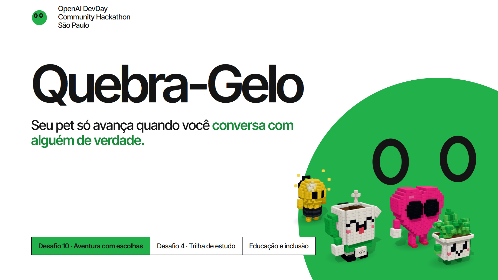

# Quebra-Gelo

**Seu pet só avança quando você conversa com alguém de verdade.**



| | |
|---|---|
| **Desafios** | nº 10 · Aventura com escolhas e consequências &nbsp;·&nbsp; nº 4 · Trilha de estudo personalizada |
| **Trilha do evento** | Educação e inclusão |
| **Demo** | <https://quebra-gelo.julioakamine.com> · telão do evento em `/tela` · pets de exemplo em `/demo` |

---

## O problema

Num evento cheio de gente, a maioria conversa só com quem já conhece. Quem chega sozinho não sabe
puxar assunto, quem puxa costuma ficar no "oi, tudo bem" e, no fim do dia, ninguém lembra de ninguém.
O networking que o evento promete acontece por acaso — e não deixa rastro.

## A solução

Um pet virtual que só avança na história quando você **encontra uma pessoa de verdade**. Você mostra o
código de 4 letras do seu pet, a outra pessoa digita (ou lê o QR), e o encontro vira um capítulo dos
dois lados. Como você conduz cada conversa decide o final — e, no fim, o pet vira o retrato de quem
você conheceu.

## Objetivos — o que a gente quer provar

| Para quem | O objetivo |
|---|---|
| **Quem está no evento** | dar um motivo concreto para falar com um estranho hoje: o jogo só destrava com gente real, então a conversa deixa de ser constrangimento e vira progresso |
| **Quem organiza** | tornar visível — e mensurável — o networking que o evento vende: pessoas com pet, encontros que aconteceram, conexões por pessoa, num telão ao vivo |
| **A trilha de educação** | ensinar as três habilidades que fazem a conversa funcionar (abordar, escutar, conectar) e pôr cada uma em prática na missão seguinte |
| **O produto** | provar que o formato é reutilizável: qualquer evento vira uma aventura cooperativa, com dados para o organizador e uma lista de contatos para o participante |

## Como funciona

### O ciclo

1. **Monte o pet** em cinco telas curtas: o bicho e o acessório, os nomes, com o que você trabalha, o
   que você procura hoje e com o que pode ajudar. Pode marcar mais de uma área em cada pergunta.
2. **Encontre alguém**: o cartão da Missão mostra o seu código e o seu QR; você digita o código da
   outra pessoa. O encontro vale **para os dois** — quem foi encontrado acorda na mesma missão.
3. **Escolha o caminho**: papo rápido soma **Alcance**; ir a fundo soma **Profundidade**. A
   consequência aparece na história na hora, com os pets de vocês em cena.
4. **Chegue a um final** e leve a lista de quem você conheceu. Dá para voltar a uma missão e tentar o
   outro caminho sem apagar nada.

### A Aventura (desafio 10)

Quatro missões — *Novas pessoas*, *Troca de ajuda*, *Cultive conexões* e *Palco DevDay* —, cada uma com
uma decisão e duas barras visíveis no topo. O progresso fica salvo no servidor, capítulo por capítulo,
com retomada no ponto em que você parou.

| Final | Como se chega |
|---|---|
| **Time dos Sonhos** | Alcance **e** Profundidade ≥ 4 — conversou muito e conversou fundo |
| **Colecionador de Crachás** | Alcance maior que Profundidade — só papo rápido |
| **Amigo de Um Só** | Profundidade maior que Alcance — só conversa funda |

### A Academia (desafio 4)

Cinco perguntas de diagnóstico medem **Abordar**, **Escutar** e **Conectar** e montam uma trilha que
começa pela habilidade mais fraca, com **três atividades** em cada uma (nove no total), todas com
explicação da resposta e progresso salvo. A trilha indica qual missão treina a habilidade fraca. A
Academia é **opcional** — fica na aba dela, com um ponto verde enquanto o diagnóstico não é feito, e não
altera o Alcance nem a Profundidade.

### O que impede o atalho

O jogo inteiro depende de interação entre pessoas, então as travas são parte da regra:

- o encontro é **mútuo** e registrado dos dois lados, com aviso "X te encontrou!";
- nas Missões 1 a 3, quem você já conhece não conta de novo — é preciso procurar gente nova;
- a Missão 4 pede o contrário: **reencontrar** alguém que você já conheceu hoje;
- cinco segundos entre encontros e bloqueio de dez minutos depois de vinte códigos errados, para não
  farmar código nem varrer o alfabeto.

## Desafios do hackathon — onde cada pedido está

| Desafio | Pedido | Onde está no projeto |
|---|---|---|
| **nº 10 · Aventura com escolhas e consequências** | história interativa, duas características, progresso salvo, dois caminhos com finais diferentes | 4 missões com uma decisão cada; **Alcance** e **Profundidade** nas barras do topo; progresso persistido no servidor e retomada por capítulo; 3 finais, com "Tente o outro caminho" para provar o segundo |
| **nº 4 · Trilha de estudo personalizada** | 5 questões diagnósticas, trilha pelos resultados, atividades com explicação, progresso | Aba **Academia**: 5 perguntas, trilha pela habilidade mais fraca, 9 atividades com explicação, progresso por habilidade e a missão que treina cada uma |

Também estão no projeto, porque a ideia não funciona sem eles: encontro por **QR ou código de 4
letras**, mundo 3D com as ilhas das missões, **telão do evento** com QR e contadores ao vivo, e a lista
**Quem eu conheci** com o LinkedIn de quem topou trocar contato (só aparece entre quem se encontrou).

## O que está pronto e verificado

Verificado em 23/10, antes da entrega:

| Item | Estado |
|---|---|
| Tipagem | `npx tsc --noEmit` limpo |
| Testes | **15 de 15** passando (`node:test`): os 3 finais, as travas, os dois perfis da Academia |
| Build | `vite build` em 3,4 s |
| Site | `https://quebra-gelo.julioakamine.com` com HTTPS, deploy automático a cada push na `main` |
| Rotas | `/health` `/` `/demo` `/tela` `/api/stats` `/api/online` respondendo `200` |
| Dados | volume persistente em `/data` (snapshot dos pets sobrevive a redeploy) |

Rotas principais da API: `POST /api/pets`, `GET /api/eu`, `POST /api/comecar`, `POST /api/encontro`,
`POST /api/escolha`, `POST /api/avancar`, `POST /api/diagnostico`, `POST /api/atividade`,
`POST /api/retomar`, `POST /api/sair`, `GET /api/demo`, `GET /api/stats`, `GET /api/online`.

## Tecnologia e arquitetura

TypeScript em tudo. **Vite** no cliente, **Three.js** no mundo e nos pets em voxel, **Express 5** no
servidor, **motion** nas animações de interface, **qrcode** no servidor para os QR de encontro. O motor
do jogo é uma função pura `(estado, ação) → estado`, sem DOM, rede ou relógio — é o que permite testar
regra de jogo sem navegador.

```
.
├── src/shared/engine.ts    motor da Aventura (estado, ação) → estado   + engine.test.ts
├── src/shared/academia.ts  motor da Academia (diagnóstico, trilha)    + academia.test.ts
├── src/shared/story.ts     espécies, acessórios, temas, textos e finais
├── src/client/main.ts      telas: criação, cartão da Missão, abas, Academia
├── src/client/world.ts     cena Three.js: 5 ilhas, viagem do pet, zonas de escolha
├── src/client/pet.ts       adapta os mascotes de assets/pets ao jogo, com animação
├── src/server/index.ts     Express: API, pets de exemplo, snapshot em data/mundo.json
├── src/server/telao.ts     o telão do evento (/tela), com QR e contadores
├── assets/pets/            os 10 mascotes voxel (fonte única): espécies, malha e galeria
└── docs/                   ideia, história, Academia, plano, auditoria e entrega
```

Os **10 pets** (Xícara, Caderninho, Laptopinho, Plantinha, Lâmpada, Coração, Globinho, Estrelinha,
Conezinho e Nuvem) são desenhados em voxel, com mochila, acessório e animação de andar, acenar e
comemorar. A galeria fica em `assets/pets/index.html`.

## Como rodar

```bash
npm install          # na rede do evento o registro oficial falha: use --registry=https://registry.npmmirror.com
npm run dev          # http://localhost:3000 (servidor e Vite na mesma porta)
npm test             # os 3 finais, as travas e as trilhas da Academia
npm run build        # build do cliente para produção
```

Variáveis de ambiente (nenhuma é segredo obrigatório para rodar local):

| Variável | Para quê |
|---|---|
| `PORT` | porta do servidor (padrão `3000`) |
| `DATA_DIR` | pasta do snapshot; em produção, `/data` (volume) |
| `PUBLIC_URL` | URL pública com HTTPS, usada nos links e nos QR |
| `NODE_ENV` | `production` para servir o build do Vite |

Em produção o app roda em **Docker** (veja o `Dockerfile`), com healthcheck em `/health`. HTTPS é
obrigatório para a câmera do celular ler o QR — há sempre o caminho sem câmera, digitando o código.

## Decisões de projeto

- **O encontro é o único jeito de avançar.** Nada progride sozinho: sem outra pessoa, não há missão.
- **Sem foto, sem cadastro longo.** O pet é montado em cinco telas e o perfil é o mínimo para sugerir
  com quem conversar. Sem upload de imagem, sem espera de geração.
- **O núcleo roda sem IA, de propósito.** A história é autoral e as sugestões saem de regra pura — o
  jogo funciona mesmo com a rede do evento ruim, e o mesmo vale para o celular.
- **Celular e computador com a mesma qualidade**: alvos de toque de 44 px, layout próprio em cada um, e
  o mesmo jogo nos dois (QR no celular, teclado no notebook).
- **Acessibilidade**: caminho sem câmera para quem não pode ou não quer usar QR, e
  `prefers-reduced-motion` desliga confete e animações mais fortes.

## Equipe

| Nome | GitHub |
|---|---|
| Julio Akamine | [@JulioAkaminee](https://github.com/JulioAkaminee) |
| Miguel Souza | [@miguelvzs](https://github.com/miguelvzs) |

## Documentação

| Documento | O que tem |
|---|---|
| [`docs/QUEBRA-GELO.md`](docs/QUEBRA-GELO.md) | a ideia, as decisões e as regras dos finais |
| [`docs/HISTORIA.md`](docs/HISTORIA.md) | os textos da Aventura |
| [`docs/ACADEMIA.md`](docs/ACADEMIA.md) | as perguntas, as atividades e a trilha |
| [`docs/PLANO.md`](docs/PLANO.md) | frentes de trabalho, contratos e status |
| [`docs/ENTREGA.md`](docs/ENTREGA.md) | roteiro do vídeo, ensaio e respostas do formulário |
| [`docs/AUDITORIA.md`](docs/AUDITORIA.md) | revisão de regras e critérios |

---

## Apêndice: o evento

**DevDay Exchange Community Hackathon — São Paulo**, 23 de outubro de 2026, das 8h às 18h (BRT), na
Biblioteca da Universidade Anhembi Morumbi (R. Dr. Almeida Lima, 1134 — Mooca, São Paulo/SP). Um dia de
construção prática em equipes, com mentoria e pitches avaliados por uma banca.

> Evento **não oficial**, liderado pela comunidade e organizado pelos **Codex Ambassadors Brasil**
> (Marcelo Okano, Matheus Pagani e Laura Napoles), com Vibe Space e Universidade Anhembi Morumbi.
> Fonte oficial: <https://luma.com/openai-hackathon-sp> · hashtag `#DevDayCommunity`

Trilhas: Produtividade e trabalho · **Educação e inclusão** · Impacto local · Projetos livres.
Premiação: US$ 1.000 / 500 / 250 em créditos de Codex para o top 3, com 12 meses de ChatGPT Pro para os
integrantes das três equipes; quem fez check-in recebeu US$ 100 em créditos Codex e US$ 50 em créditos
de API, conforme as regras do programa.

Regras do repositório: nada de segredo comitado (`.env`, chaves, tokens), commits pequenos com mensagem
no imperativo e README atualizado antes de cada demo.
