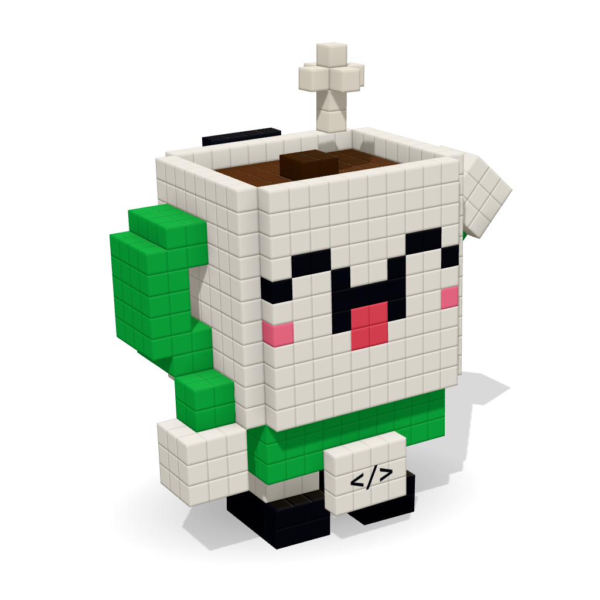
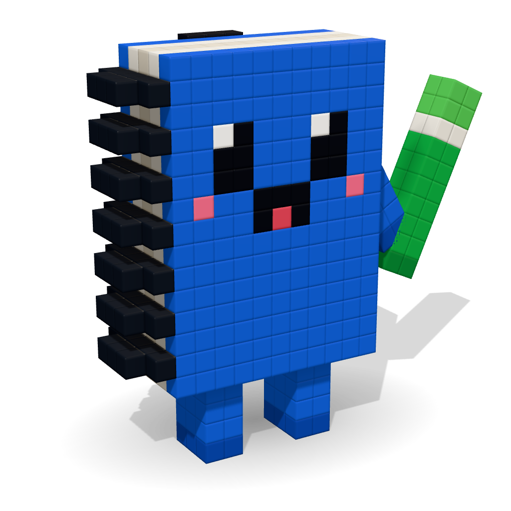
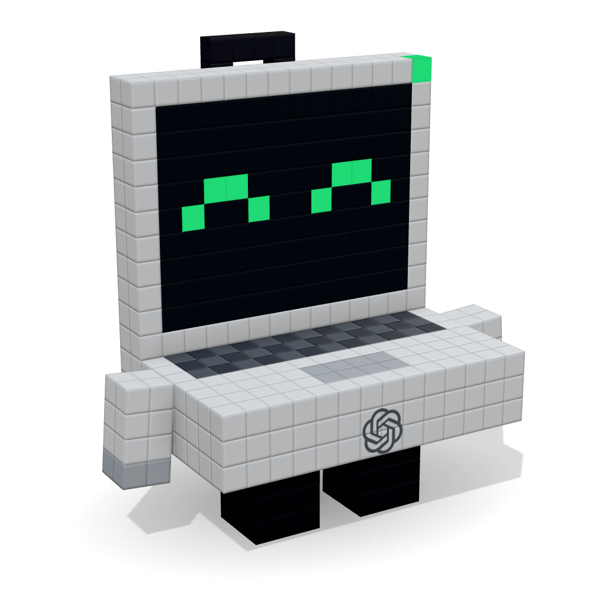
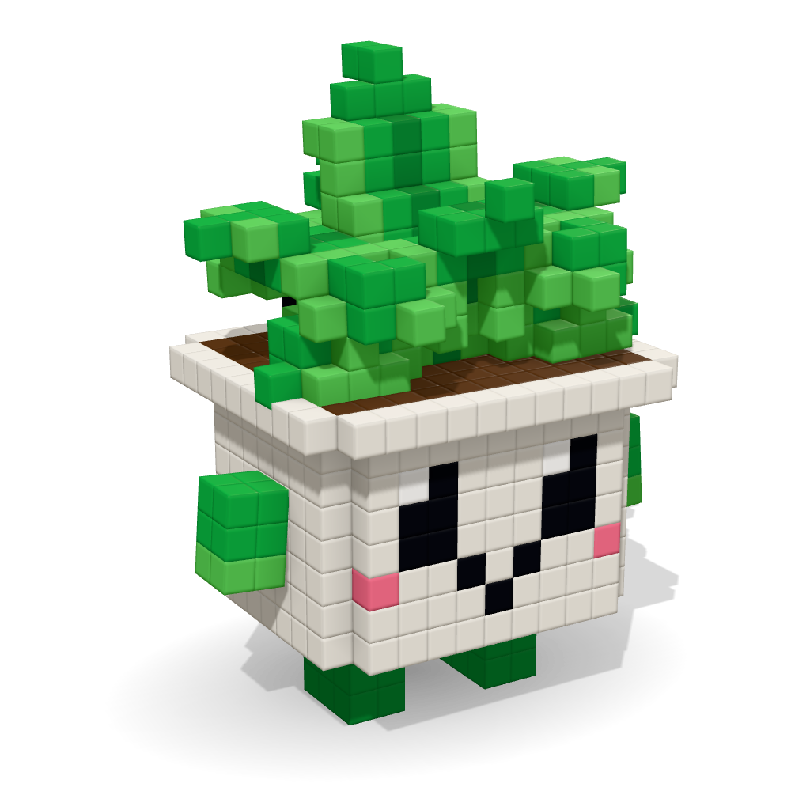
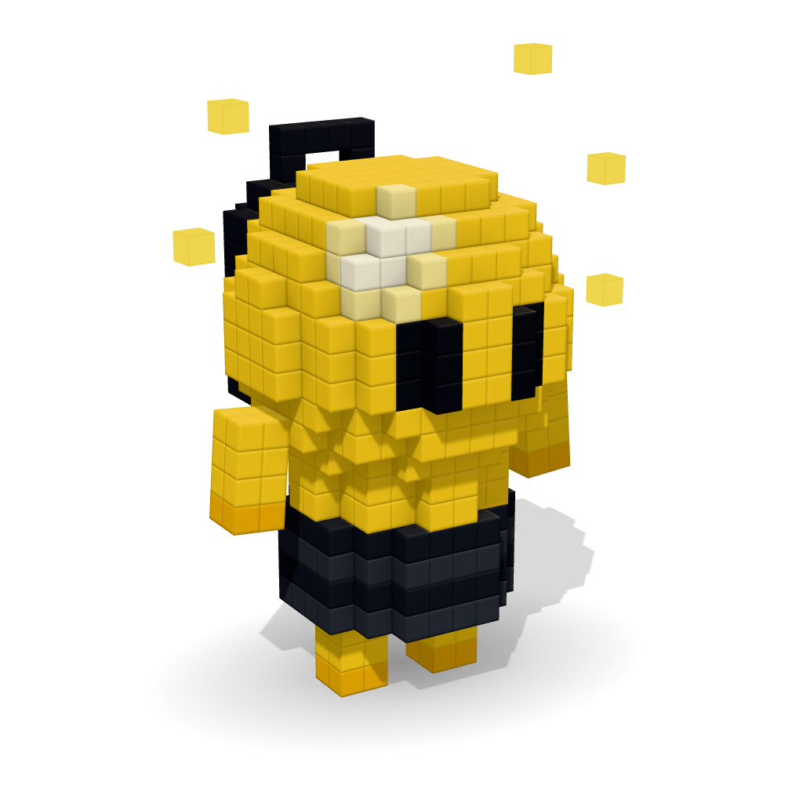
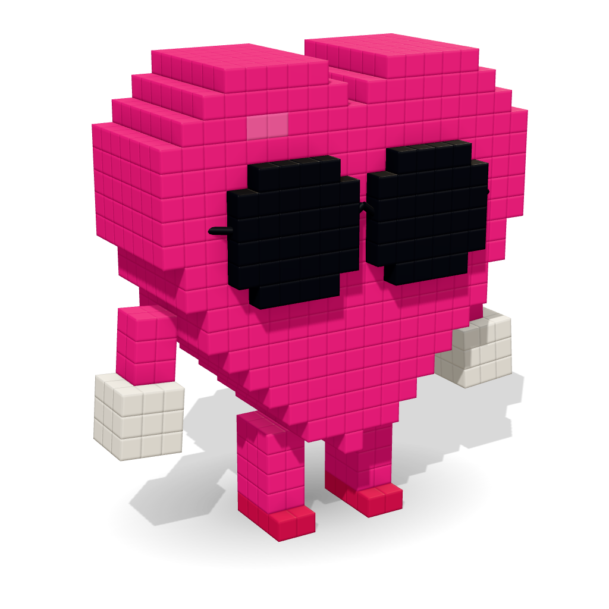
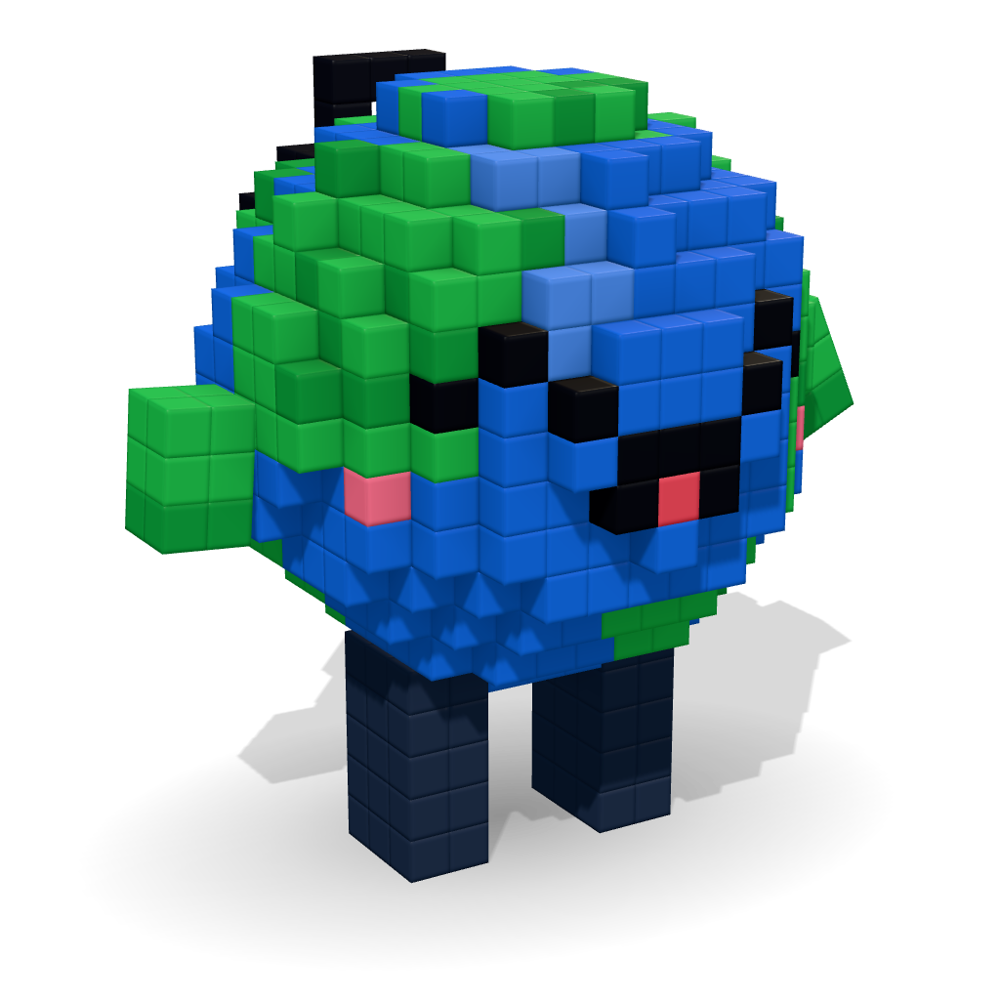
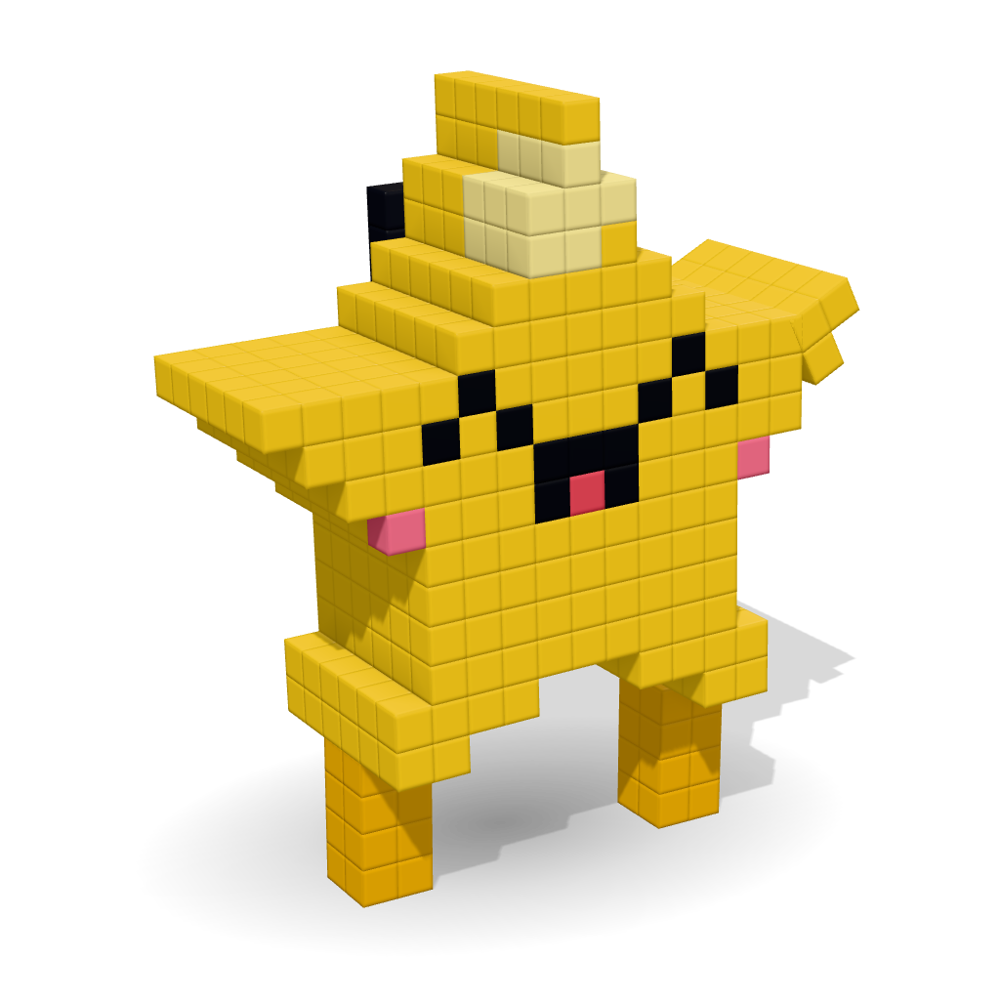
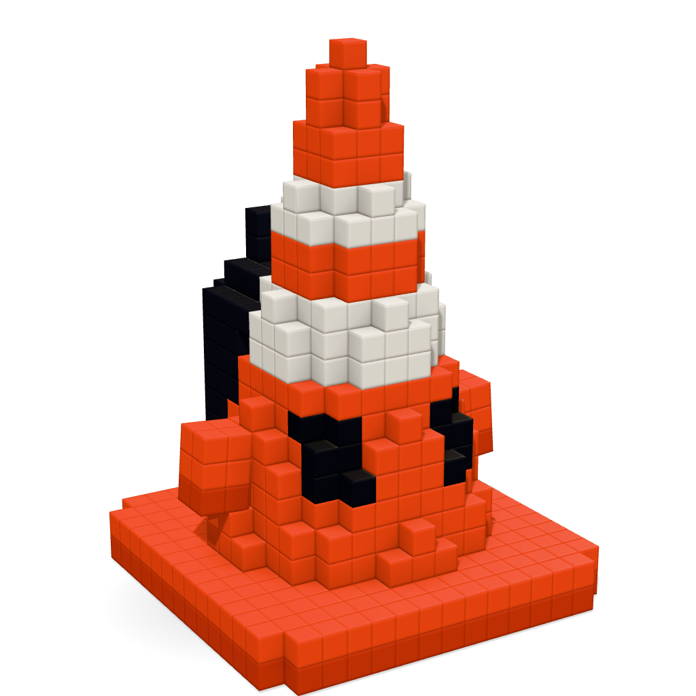
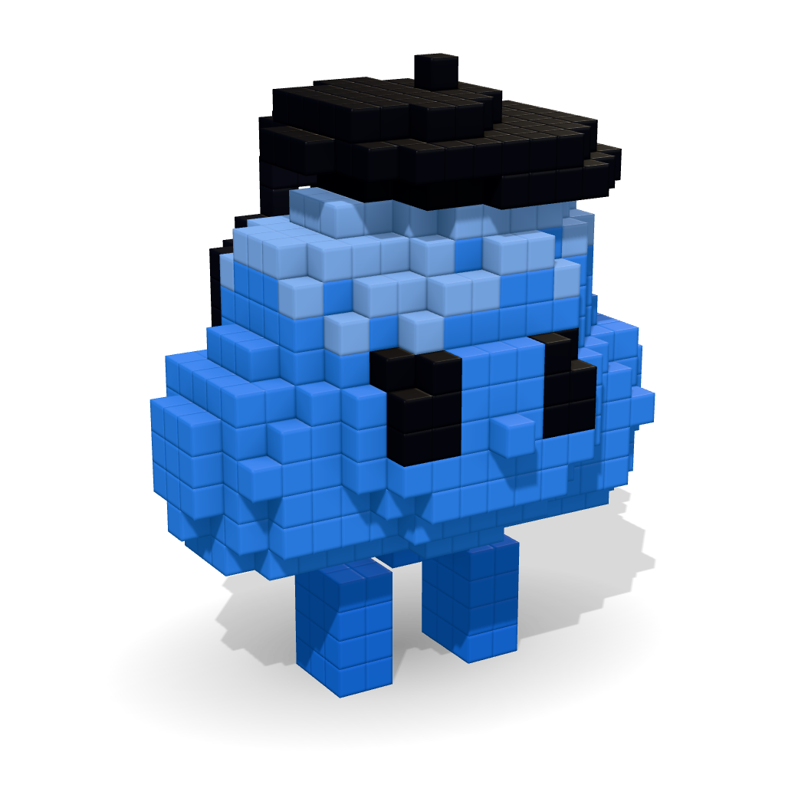

# Pets do evento (assets)

Os 10 pets do Quebra-Gelo em **voxel 3D**, feitos a partir da referência
[`docs/referencias/pets-do-evento-v1.png`](../../docs/referencias/pets-do-evento-v1.png). Os modelos são
gerados por código: não há arquivo de modelagem externo para manter.

O estilo segue a referência:
- cubos grandes e rostos de poucos blocos;
- plástico macio, com a beirada de cada cubo levemente arredondada;
- estampas nítidas (logo e texto) aplicadas como adesivos por cima dos voxels.

**Todos os pets usam uma mochila preta com a logo da OpenAI nas costas.**

| | Pet | Personalidade | Voxels | Tamanho (L × A × P) |
|---|---|---|---|---|
|  | **01 Xícara** | Curioso e sempre puxa assunto. | 1.868 | 18 × 23 × 13 |
|  | **02 Caderninho** | Organizado e adora trocar ideias. | 1.190 | 17 × 19 × 9 |
|  | **03 Laptopinho** | Criativo e sempre tem um projeto. | 974 | 18 × 19 × 12 |
|  | **04 Plantinha** | Tranquila e faz conexões inesperadas. | 1.271 | 15 × 20 × 13 |
|  | **05 Lâmpada** | Cheio de ideias e energia. | 1.309 | 19 × 23 × 13 |
|  | **06 Coração** | Empático e sempre escuta de verdade. | 2.105 | 21 × 22 × 11 |
|  | **07 Globinho** | Adora gente de todas as áreas. | 1.264 | 17 × 17 × 14 |
|  | **08 Estrelinha** | Animado e sempre incentiva os outros. | 871 | 17 × 20 × 9 |
|  | **09 Conezinho** | Direto e ajuda a focar no objetivo. | 1.293 | 15 × 21 × 15 |
|  | **10 Nuvem** | Observador e sempre vê o lado diferente. | 1.529 | 17 × 20 × 15 |

## Arquivos

| Arquivo | O que é |
|---|---|
| `especies.js` | **Fonte da verdade.** A paleta e a construção de cada pet, voxel a voxel |
| `voxel.js` | Ferramentas de modelagem (caixa, esfera, cilindro, extrusão, desenhar o rosto, decalques, hastes), sem dependências |
| `malha.js` | Transforma os dados em malha Three.js (só as faces visíveis, sombreamento nos cantos e bisel macio), cria os decalques e anima |
| `logo.js` | Desenho vetorial da logo da OpenAI, usado nos decalques |
| `index.html` | Galeria para ver, girar, animar e baixar cada pet |
| `json/<id>.json` | Os dados de cada pet, prontos para o jogo carregar sem rodar `especies.js` |
| `png/<id>.png` | Imagem 1024 × 1024 com fundo transparente, para README, slides e vídeo |
| `exportar.mjs` | Regenera a pasta `json/` |

## Ver a galeria

Os módulos JavaScript só carregam por HTTP, então é preciso servir a pasta:

```bash
cd assets/pets && python3 -m http.server 8765
# abra http://localhost:8765
```

Na galeria, passar o mouse faz o pet comemorar. Clicar abre o detalhe, que tem:
- vistas de 3/4, frente, lado, costas e de cima;
- as 5 animações;
- liga e desliga dos acessórios;
- paleta, ficha técnica e download de PNG e JSON.

O Three.js vem da CDN (jsDelivr), então a página precisa de internet.

## Usar no jogo

```js
import { gerarPet } from './assets/pets/especies.js';
import { criarPet3D, animarPet, mostrarParte } from './assets/pets/malha.js';

const pet = criarPet3D(gerarPet('xicara')); // ou: criarPet3D(await (await fetch('json/xicara.json')).json())
pet.raiz.scale.setScalar(0.1);              // 1 voxel = 1 unidade; ajuste ao tamanho do mundo
cena.add(pet.raiz);

// a cada quadro
animarPet(pet, relogio.getElapsedTime(), 'andar'); // parado | andar | pular | acenar | comemorar
pet.raiz.rotation.y = direcao;

mostrarParte(pet, 'mochila', false);               // acessórios podem ser escondidos
```

`malha.js` também exporta `criarEstudio()` (luzes e sombra da galeria), `enquadrar()` (câmera) e
`configurarRenderizador()`.

## Formato dos dados (`json/<id>.json`)

```jsonc
{
  "id": "xicara", "numero": 1, "nome": "Xícara", "personalidade": "...",
  "animacao": "acenar",            // animação padrão na galeria
  "pose": { "bracoD": 0.45 },      // ângulo de repouso dos braços (radianos), quando houver
  "escala": 1,                    // voxels por unidade do projeto
  "paleta": ["#f6f3ec", "#3ee07f*", ...], // '*' = voxel que brilha (não recebe luz)
  "limites": { "min": [x, y, z], "max": [x, y, z] },
  "tamanho": [largura, altura, profundidade],
  "totalVoxels": 2378,
  "partes": [
    { "nome": "corpo",  "tipo": "corpo", "pai": "raiz",  "pivo": [7, 3, 6], "voxels": [[x, y, z, corDaPaleta], ...] },
    { "nome": "bracoD", "tipo": "braco", "pai": "corpo", "pivo": [14.5, 10.5, 6], "lado": "D", "levantar": 2.4, "voxels": [...] }
  ],
  "decalques": [                  // estampas planas e nítidas sobre a superfície
    { "parte": "mochila", "tipo": "logo", "centro": [6, 12, -3], "normal": [0, 0, -1], "largura": 5.2, "altura": 5.2, "cor": "#f3f4f6" },
    { "parte": "corpo", "tipo": "texto", "texto": "</>", ... }
  ],
  "hastes": [                     // arames finos, como a armação dos óculos do Coração
    { "parte": "oculos", "de": [x, y, z], "para": [x, y, z], "raio": 0.17, "cor": "#17181b" }
  ],
  "ancoras": { "cabeca": [x, y, z], "rosto": [...], "costas": [...] }
}
```

- **Coordenadas:** y para cima, a frente olha para +z, e a esquerda de quem olha é −x.
- **Partes:**
  - `corpo` é a parte principal;
  - `braco` e `perna` são as partes animadas;
  - `item` é um acessório preso a outra parte, como mochila, óculos, boina, caneta ou folhas;
  - `flutuante` balança sozinho, como o vapor ou os brilhos.
- **Pivô:** cada parte gira em torno do próprio `pivo`, no espaço do modelo.
- **Âncoras:** pontos para prender itens novos, como os itens das barras (crachás, coraçãozinho, capa).

## Editar ou criar um pet

1. Altere ou acrescente uma entrada em `PETS`, no arquivo `especies.js`. As funções de rosto
   (`olhosFelizes`, `olhosOvais`, `bochechas`), de membros (`braco`, `pernas`) e a `mochila` já estão
   prontas.
2. Rode `node assets/pets/exportar.mjs` para atualizar `json/`.
3. Confira na galeria e baixe o PNG pelo botão do detalhe.

## Diferenças em relação à referência

- **Mochila em todos:** a referência só mostra a mochila em alguns pets; aqui todos usam uma, com a logo
  da OpenAI estampada nas costas. A logo também aparece na base do Laptopinho, como na referência.
- **Caderninho:** sem a etiqueta branca da capa.
- **Texto:** "Oriativo" virou "Criativo".
- **Nome:** a caneca se chama **Xícara**, como na referência dos pets. No mapa da aventura ela aparece
  como "Xícaro".
