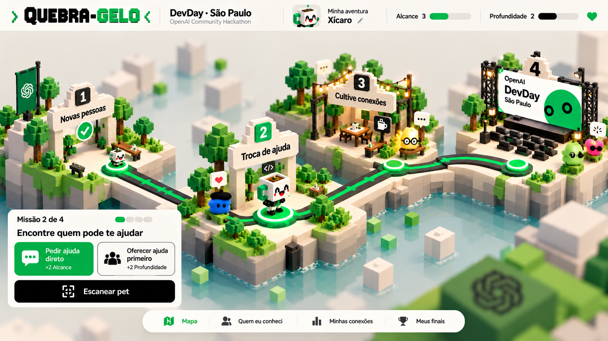
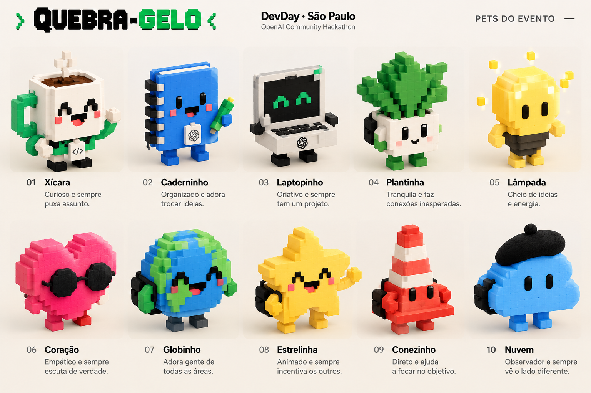

# Referências visuais

## `mapa-aventura-v1.png`

Referência da tela do **mapa da aventura**, em estilo voxel isométrico. Recebida em 23/10/2026.

### O que a tela mostra
- **Cabeçalho:**
  - logo "QUEBRA-GELO" em fonte pixelada;
  - "DevDay · São Paulo / OpenAI Community Hackathon";
  - avatar e nome do pet ("Minha aventura: Xícaro"), com um lápis para editar;
  - barras de **Alcance** (verde) e **Profundidade** (preta), cada uma com o valor ao lado;
  - um coração.
- **Mapa:** ilhas de voxel sobre a água, uma por missão, ligadas por um caminho verde com marcadores.
  1. **Novas pessoas:** concluída, com um ✓.
  2. **Troca de ajuda:** a missão atual, com o pet do jogador em cima do marcador.
  3. **Cultive conexões:** mesas, café e varal de luzes.
  4. **Palco DevDay São Paulo:** com telão e plateia.
- **Outros pets** espalhados pelo mapa, com balões (coração, "…").
- **Cartão da missão** (canto inferior esquerdo):
  - "Missão 2 de 4", com o progresso em 4 pontos;
  - o título "Encontre quem pode te ajudar";
  - duas escolhas com o efeito escrito: **Pedir ajuda direto (+2 Alcance)**, em verde cheio, e
    **Oferecer ajuda primeiro (+2 Profundidade)**, só com contorno;
  - um botão preto **Escanear pet**.
- **Navegação inferior:** Mapa · Quem eu conheci · Minhas conexões · Meus finais.
- **Estilo:** verde vivo, preto e creme; água azul-clara; cantos arredondados e sombras suaves; fundo
  desfocado, com profundidade de campo.

### Pontos a alinhar com [`QUEBRA-GELO.md`](../QUEBRA-GELO.md)
- **Como se escolhe:** aqui a escolha é por **botões no cartão**. A decisão D5 diz que a escolha
  acontece **andando até uma zona** dentro da fase 3D.
- **Menu:** a navegação não tem **Credenciamento** nem **Academia**, que fazem parte da decisão D6.
- **Marca:** a imagem usa o logo e o nome da OpenAI. Como o evento é não oficial, é preciso confirmar
  com os organizadores se a marca pode aparecer no produto.

---

## `pets-do-evento-v1.png`

Referência dos **pets**: 10 objetos do dia a dia de um evento, em voxel, cada um com nome e
personalidade. Recebida em 23/10/2026.

**Já virou asset:** os 10 pets estão modelados em [`assets/pets/`](../../assets/pets/README.md), com
galeria 3D, animações, JSON e PNG de cada um.

| # | Pet | Personalidade | Visual |
|---|---|---|---|
| 01 | **Xícara** | Curioso e sempre puxa assunto. | caneca branca com alça verde, café, selo `</>` no peito |
| 02 | **Caderninho** | Organizado e adora trocar ideias. | caderno azul de espiral, segurando uma caneta verde |
| 03 | **Laptopinho** | Criativo e sempre tem um projeto. | notebook cinza com olhos `^ ^` verdes na tela |
| 04 | **Plantinha** | Tranquila e faz conexões inesperadas. | vaso branco com folhas verdes e mochila preta |
| 05 | **Lâmpada** | Cheio de ideias e energia. | lâmpada amarela com brilhos em volta |
| 06 | **Coração** | Empático e sempre escuta de verdade. | coração rosa com óculos escuros redondos |
| 07 | **Globinho** | Adora gente de todas as áreas. | globo azul e verde com mochila |
| 08 | **Estrelinha** | Animado e sempre incentiva os outros. | estrela amarela acenando, com mochila |
| 09 | **Conezinho** | Direto e ajuda a focar no objetivo. | cone de trânsito laranja e branco |
| 10 | **Nuvem** | Observador e sempre vê o lado diferente. | nuvem azul com boina preta e mochila |

### Estilo em comum
- Corpo de cubinhos (voxel), com olhos pretos simples e bochechas rosadas.
- Braços e pernas curtos e quadrados.
- Cores chapadas e saturadas, em fundo creme.
- Acessórios que se repetem: **mochila, óculos escuros, boina, caneta, brilhos**.

### Pontos a alinhar com [`QUEBRA-GELO.md`](../QUEBRA-GELO.md)
- **Quantidade de espécies:** a imagem tem **10**. A decisão D1 fala em **6 espécies × 8 cores × 4
  acessórios**. Esta referência pode resolver a pendência "lista de espécies, cores e acessórios".
- **Nome do pet da caneca:** aqui ele se chama **Xícara**; no mapa da aventura, **Xícaro**.
- **Erro de digitação:** a imagem traz "Oriativo" no Laptopinho. No produto, usar "Criativo".
- **Marca:** o logo da OpenAI aparece no Caderninho e no Laptopinho. É a mesma ressalva do mapa.
- **Ideia:** algumas personalidades combinam com as habilidades da Academia. Xícara (puxa assunto) →
  Abordar; Coração (escuta) → Escutar; Globinho (gente de todas as áreas) → Conectar. Esses pets
  podem virar os instrutores ou os pets de exemplo da semente.
